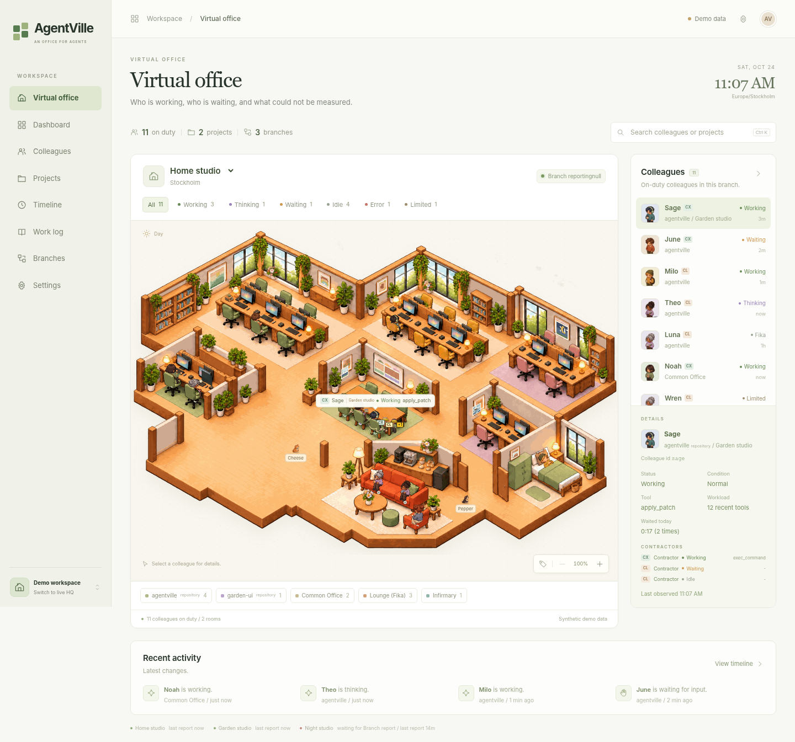

# AgentVille

A self-hosted, read-only virtual office for AI coding agents (Claude Code, Codex). Each host runs a Collector that watches local agent sessions; one host runs HQ, which shows every colleague's state as an office floor in the browser.



AgentVille observes only. It never starts, resumes, answers, or interrupts an agent. Prompts, commands, file paths, and tool arguments never leave the host.

```
Branch (every host with agents)               HQ (one host)                    Browser
+----------------------------------+  HTTPS   +---------------------------+     +-----------------+
| Collector                        |--------->| ingest, SQLite, live push |---->| office, views,  |
| Claude Code sessions, Codex      | outbound | serves the Web UI         |     | EN / KO         |
+----------------------------------+   only   +---------------------------+     +-----------------+
```

## Quick start

Linux with Python 3.12 or later (Debian 13, Ubuntu 24.04, Rocky Linux 9/10):

```bash
git clone https://github.com/jeonghanlee/agentville.git ~/.local/src/agentville
cd ~/.local/src/agentville
python3 -m venv ~/.local/opt/agentville && ~/.local/opt/agentville/bin/pip install '.[hq]'
mkdir -p ~/.local/bin && ln -sf ~/.local/opt/agentville/bin/agentville-* ~/.local/bin/
export PATH="$HOME/.local/bin:$PATH"   # a new login does this on Debian/Ubuntu once ~/.local/bin exists
agentville-hq &               # http://127.0.0.1:8470
agentville-collector
```

Open `http://127.0.0.1:8470/`. `http://127.0.0.1:8470/?demo=1` shows fictional colleagues. The quick start runs in this terminal; stop it (Ctrl-C, then `kill %1`) before installing the services.

To install as systemd user services, latest release (`--hq` on the HQ host; without it, the Collector only):

```bash
curl -fsSL https://raw.githubusercontent.com/jeonghanlee/agentville/master/install.sh | bash -s -- --hq
```

For other hosts and TLS, follow the Installation chapter.

## Documentation

User manual: [jeonghanlee.github.io/agentville](https://jeonghanlee.github.io/agentville/)

| Chapter | Content |
|---|---|
| [Installation](docs/install.md) | Services, other hosts, TLS, upgrade, removal. |
| [Configuration](docs/configuration.md) | The Collector configuration file. |
| [Using the Office](docs/using.md) | Rooms, states, views, settings. |
| [Data and Security](docs/data.md) | What is sent to HQ and what never is. |

Specifications: [Architecture](docs/architecture.md), [Protocol](docs/protocol.md), [Test Fixtures](docs/fixtures.md).

Release history: [CHANGELOG](CHANGELOG.md).

## Development

```bash
python3 -m venv .venv && .venv/bin/pip install -e '.[hq,test]'
.venv/bin/python -m pytest -q
```

Test data is synthetic, produced by `tests/fixtures/*/generate.py`; real logs are never committed. The manual is built with `mdbook build` (output in `build/book`).

## License

Apache License 2.0. See [LICENSE](LICENSE) and [NOTICE](NOTICE); artwork provenance in [docs/design/artwork.md](docs/design/artwork.md).
