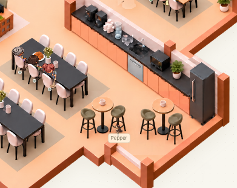
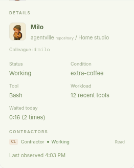
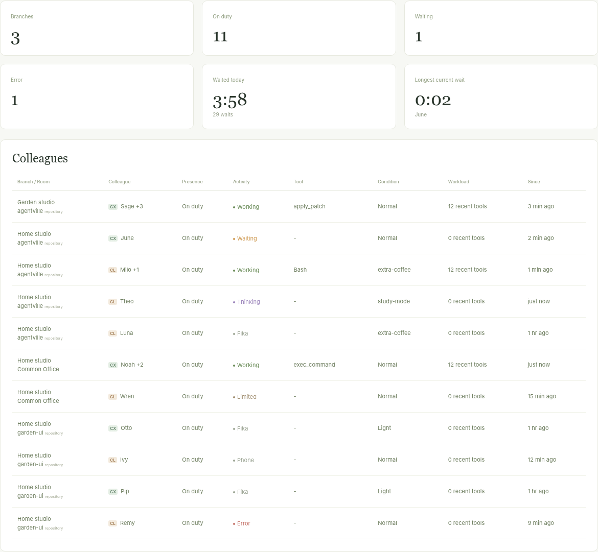
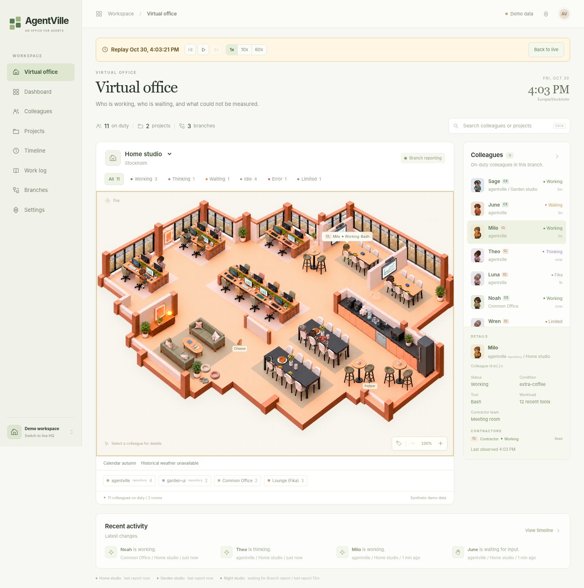
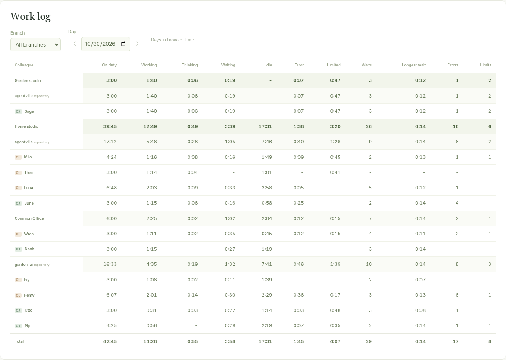
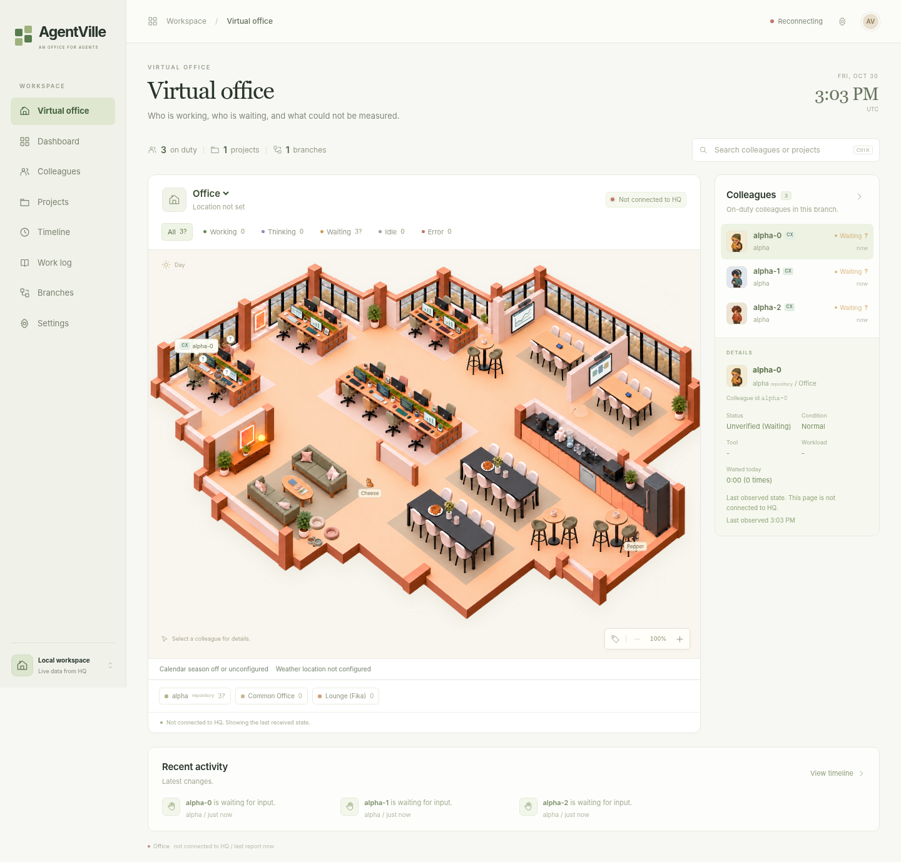
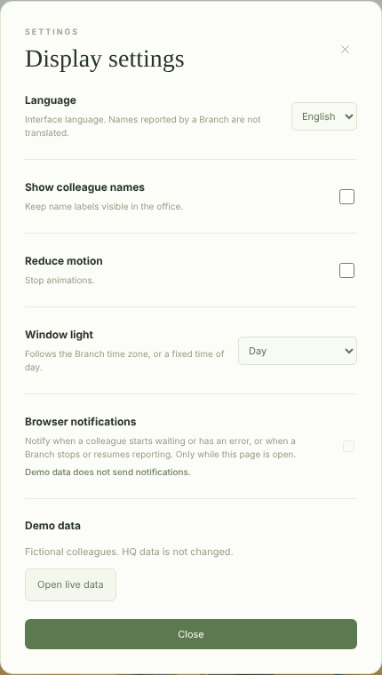

# Using the Office

## Scope

This document covers the office page served by HQ: places, states, views, and settings.

**Out of scope:** how the Collector decides states (docs/architecture.md in the repository).

Open HQ in a browser, for example `http://127.0.0.1:8470/`. With a viewer token, open `.../#token=<viewer token>` once; the page keeps the token for the browser session. `/?demo=1` shows fictional colleagues without connecting to HQ. Screenshots use this demo. The disconnected example uses synthetic reports in an isolated HQ; production data is not used.

## Virtual office

One floor per Branch. The Branch selector at the top of the office card switches Branches; the clock and window light follow the Branch's time zone.

| Place | Who is there |
|---|---|
| Project area | Colleagues working in that repository, with priority for its desks. The name is the repository; the sublabel reads "repository". |
| Common Office | Colleagues working outside any repository; they use available desks. |
| Meeting rooms | Two rooms, each seating up to six colleagues of a different Project after 60 seconds of observed concurrent work, or one colleague working with its Contractors. |
| Lounge (Fika) | Colleagues idle for an hour or more, with the default thresholds; each Branch can set its own ([Configuration](configuration.md)). |

The single floor has 20 desks: three window areas with four places each and a central area with eight. The arrows beside the room tabs page through four Projects at a time. Colleagues take their Project's available desks first, then share other vacancies with Common Office. Occupants keep their desks until they leave; arrivals do not move existing occupants. Further colleagues appear as "+N" when all desks are reserved.

Meeting participants appear at the table on every Project page. Their held desks remain reserved and empty, and their Project filters and colleague details continue to work. Waiting, error, limits, or going off duty ends membership immediately; other non-working states have a 30-second grace period. Meetings are presentation only and do not record collaboration.

Each meeting table has a touch controller, and each wall display has a camera and microphone bar. These are decorations and do not connect to a meeting service. Meeting displays and desk monitors facing the viewer show changing fictional content; reduced motion, replay, and a hidden office pause the changes. A Limited colleague's visible desk monitor stays dark until that state ends.

Fika has 28 places: 16 around two tables, six on two sofas, and six at three high tables. Colleagues fill these places before joining a waiting line. An Error colleague uses a desk and retains the error status; this floor has no infirmary or bed. Live arrivals enter between the sofas and Fika. Colleagues walk between places on the same floor; reduced motion places them directly. `/?demo=seats` and `/?demo=meeting` display all 60 seat ids, including both six-person meetings.

Seated figures keep the proportions of the painted artwork at every zoom level.

Each colleague wears a provider badge (`CL` Claude, `CX` Codex). Contractors (subagents) wear a yellow hard hat and their own provider badge.

### Contractor teams

A colleague that has had Contractors for 10 seconds works with them away from its desk:

1. In a free meeting room: the colleague takes the first chair and its Contractors the next chairs.
2. With both meeting rooms in use: at a free Fika table or sofa.
3. With neither free: at its desk, with its Contractors standing nearby where they do not cover other colleagues.

The colleague's desk stays reserved and empty while the team is away. Contractors without a chair appear as "+N" on the last seated Contractor. A meeting keeps its room when a team forms, and a team keeps its room when a meeting could start. A meeting member brings its Contractors to free chairs of its meeting room.

The team ends 10 seconds after its last Contractor finishes, or at once when the colleague starts waiting, has an error, reaches a limit, or goes off duty. The colleague and its Contractors then walk back to the desk. Reduced motion and replay place them directly. Teams are presentation only and do not record collaboration. The demo (`/?demo=1`) shows one fixed team in the second meeting room.

## Activity states

| Label | 한국어 | Shown as |
|---|---|---|
| Working | 작업 중 | Typing and using the mouse. |
| Thinking | 생각 중 | Thought bubble. Not produced from current provider signals, so it appears only in demo data (`/?demo=1`), as in the screenshots. |
| Waiting | 대기 | Raised hand and "!". The agent waits for a person's answer or approval. |
| Idle | 유휴 | At the desk; with the default thresholds, after 5 minutes on the phone, after 30 minutes dozing, after an hour in the Lounge. The thresholds are set per Branch ([Configuration](configuration.md)). |
| Closed | 닫힘 | A short check mark when a turn ends. |
| Error | 오류 | At a desk, with an error mark. |
| Limited | 한도 | Screen off and a clock; the detail shows when the usage limit resets. |
| Not measured | 재지 못함 | Dimmed with "?". The state could not be determined. |

A Codex run that does not use the Codex app-server daemon (e.g. `codex exec`) is observed from its rollout file only, with low confidence: it never shows Waiting, shows Not measured until its next turn or tool when it was already running at Collector start, and goes off duty 30 minutes after its rollout was last written.

In the Lounge, colleagues drink, read, and talk to each other with picture bubbles. They can visit the coffee machine, water, sink, or refrigerator. During breakfast, lunch, and dinner hours in the Branch time zone, they can collect food from the refrigerator and heat it in the microwave. These activities are decoration; they do not report agent data.

Select Cheese or Pepper in the office to see the cat's name, description, and likes. Each cat roams for about 30 minutes, then returns to its own bed beside the lounge and sleeps for 10 minutes. Food and water bowls are nearby. The cycle pauses when the office is hidden or reduced motion is enabled.

## Presence

| Label | 한국어 | Meaning |
|---|---|---|
| On duty | 출근 | A provider process or thread is running (for a Codex run outside the app-server daemon: its rollout was written in the last 30 minutes). |
| Off duty | 퇴근 | It ended. |
| On leave | 휴가 | Off duty for seven days (default threshold, set per Branch). |

## Colleague details

Select a colleague in the office or in the list on the right. The detail shows status, condition, tool name, recent tool count (tools started in the last 5 minutes, falling to 0 without new tools), room and Branch, Contractors, the last observed time, and the colleague id in small text.

A colleague is named by provider and seat, for example "Codex 2"; seat numbers are unique per provider on a Branch. A display name set for the colleague id under `aliases` in the Collector configuration of the colleague's Branch replaces it everywhere in the page ([Configuration](configuration.md)). Conditions are set by model settings: study-mode (high effort), extra-coffee, light (low effort), or normal.

## Other views

| View | Content |
|---|---|
| Dashboard | Counts across all Branches: on duty, waiting, errors, Branches; "Waited today", the total waiting time of all colleagues since midnight (browser time) with the number of waits; "Longest current wait", the colleague waiting longest right now; and a table of colleagues. |
| Colleagues | Every colleague with Branch, room, presence, activity, tool, condition, workload, and time in state. Idle colleagues show the stage of the Idle state: Idle (유휴), Phone (휴대폰), Dozing (조는 중), or Fika (휴게실). |
| Projects | One card per repository with colleagues on duty and Branches. |
| Timeline | Recorded changes of one day and the replay control (below). |
| Work log | Time each colleague spent in each state on one day (below). |
| Branches | Each Branch, whether it is reporting, and its last report time. |

The search field filters colleagues and projects; the state chips above the office filter by activity. The Colleague detail also shows "Waited today": the waiting time since midnight (browser time) and how many times the colleague started waiting.

## Timeline and replay

The Timeline lists what HQ recorded on one day, newest first: colleagues starting and stopping work, waiting, errors, limits, going on or off duty, and Branches stopping or resuming reports. Times follow the time zone of the Branch shown in the office.

Replay (되감기) shows the office as it was at an earlier time:

- Pick a day, then move the time slider, select an entry in the list, or press play. Speeds are 1x, 10x (a minute in 6 seconds), and 60x (a minute per second). The step buttons jump to the previous or next recorded change.
- Replay does not show meetings. Contractor teams are shown from the replayed state, without walking.
- While replaying, a banner with the replay time appears on every page. The office, lists, details, clock, and window light show that time, so the Virtual office can be watched while it plays. The banner holds the same controls.
- "Back to live" (or Escape) returns to the current state. Live data keeps arriving during replay; browser notifications are not sent while replaying.
- HQ keeps 30 days of history by default (Installation Section 4). An HQ upgraded from 0.1.0 has history from the upgrade on.

## Work log

The Work log (근무 일지) shows, for one day, how long each colleague was on duty and in each state, grouped by Branch and Project with subtotals. Durations are hours and minutes (`h:mm`).

| Column | Meaning |
|---|---|
| On duty | Time on duty while the Branch was reporting. |
| Working, Waiting, Idle, Error, ... | Time in each state; together they equal On duty. Rare states appear only when used. |
| Unobserved | Time on duty during which the Branch was not reporting, counted from three missed heartbeats (about 90 s with the default interval), as for "Waiting for Branch report"; not counted in the other columns. |
| Waits | How many times the colleague started waiting. |
| Longest wait | The longest single wait. |
| Errors, Limits | How many times the colleague entered Error or Limited. |

Choose a Branch to see its colleagues with days in that Branch's time zone; "All branches" uses browser time. The arrows move one day back or forward.

## When data is not fresh

- When the page loses HQ, it shows "Not connected to HQ" and reconnects by itself.
- When a Branch stops reporting, its colleagues keep their last observed place and state, dimmed and marked "?" (unverified).
- After HQ restarts, a Branch shows "Waiting for Branch report" until its Collector sends again (up to about a minute).

## Settings

| Setting | Effect |
|---|---|
| Language | English or 한국어. Names reported by Branches are not translated. |
| Show colleague names | Keeps name labels visible in the office. |
| Reduce motion | Stops animations. |
| Window light | Branch time, or a fixed time of day. |
| Calendar season | Branch date and the hemisphere configured at HQ, a fixed season, or Off. Missing or equatorial coordinates have no automatic season. This is a calendar label, not measured climate. |
| Show regional forecast | Shows the regional forecast received by HQ and effects within the windows. Turning this display off does not disable HQ retrieval. |
| Browser notifications | Notifies when a colleague starts waiting or has an error, and when a Branch stops or resumes reporting. Only while the page is open in a browser tab. Needs HTTPS or localhost and the browser's permission; off by default. |
| Demo data | Shown in demo mode (`/?demo=1`): fictional colleagues, HQ data unchanged. "Open live data" returns to HQ. |

The office forecast line shows a condition and Celsius temperature, the forecast issue time, and MET Norway attribution. Unconfigured location, loading, unavailable, and out-of-date data have distinct labels. Expired data does not drive current-weather effects. The forecast is a model result for the configured city, not a local measurement. See [regional forecast setup](install.md#69-configure-regional-forecasts).

A clear daytime forecast gives the view outside a light blue and green tint.

Rain, snow, and cloud effects stay within the painted windows. Reduced motion makes them static. The office artwork, furniture, and colleague proportions remain unchanged. Calendar-season and weather-display choices persist in browser storage when available.

Replay shows "Historical weather unavailable" and hides current-weather effects. Calendar season and window light follow the replay timestamp. Demo shows a labeled fictional forecast and makes no weather requests.
